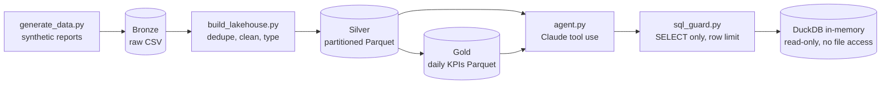

# Trust & Safety Lakehouse Agent

Ask questions about moderation data in plain language. An LLM agent writes the SQL, runs it against a small lakehouse, and explains the result.

> All data is **synthetic**. No real company or user data is used.

```
You: Which category had the most reports last week, and how fast were they resolved?
Agent: <SQL it ran> + a short explanation based on the actual query result
```
<!-- TODO: replace with a real screenshot or 20s GIF of your own run -->

## Architecture



- **Bronze / Silver / Gold** (medallion): raw data, cleaned data, aggregated KPIs.
- **Agent**: Claude gets one tool, `run_sql`. It loops (max 5 steps), can fix its own SQL errors, and must base its answer on the returned rows.
- **Safety**: LLM-generated SQL is untrusted. It passes a validator (single `SELECT`/`WITH`, keyword blocklist, forced `LIMIT`) and runs on a connection with external access disabled and configuration locked.

## Run it

```bash
python -m venv .venv && source .venv/bin/activate
pip install -r requirements.txt
cp .env.example .env            # add your ANTHROPIC_API_KEY

python -m src.generate_data     # data/bronze/reports.csv
python -m src.build_lakehouse   # data/silver/..., data/gold/...
python -m src.agent "Which category had the most reports last week?"
pytest
```
## About the API key

The data pipeline and the tests run fully offline and need no key.

The agent calls the Claude API, which is billed per use. I have **not** included a key,
and the repo never will. To try the agent, create your own key at
console.anthropic.com, put it in `.env` (see `.env.example`), and run:

    python -m src.agent "Which category had the most reports last week?"

A handful of questions costs a few cents. `.env` is git-ignored, so your key is never committed.

## Design decisions

- **DuckDB first, Spark later.** The data fits on a laptop, so DuckDB is faster to iterate on. The SQL and the Parquet layout carry over to Spark/Delta unchanged.
- **Silver is partitioned by `report_date`**, which is how Trust & Safety queries usually filter.
- **Why a guard *and* a locked connection?** A keyword blocklist alone can be bypassed; the locked connection is the real boundary.
- **Known limits:** the blocklist is conservative (it may reject a harmless query), and the agent only knows two tables.

## Roadmap

- [ ] Spark + Delta Lake version of the silver/gold step
- [ ] Kafka stream feeding bronze (`docker compose`)
- [ ] Small eval set: 15 questions with expected answers, to measure SQL accuracy
